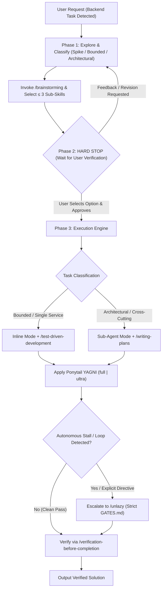
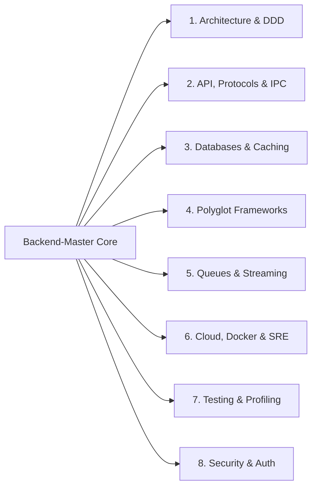

<p align="center">
  
</p>

<p align="center">
  <strong>The Universal Backend Engineering Orchestrator &amp; Curated Skill Hub for AI Agents</strong><br>
  <em>Production Architecture, Polyglot Frameworks, Distributed Systems, Containerization, Testing &amp; Security</em>
</p>

<p align="center">
  <a href="https://github.com/vatsalmehta09/Backend-Master/actions"></a>
  <a href="skills/"></a>
  <a href="REFERENCES.md"></a>
  <a href="LICENSE"></a>
  
</p>

---

## 📖 Table of Contents

- [⚡ What is Backend-Master?](#-what-is-backend-master)
- [🧩 Why Backend-Master? (The 4 Foundational Problems)](#-why-backend-master-the-4-foundational-problems)
- [🧠 In-Session Memory Engine (LTM & STM)](#-in-session-memory-engine-ltm--stm)
- [🔒 The Hardcoded Workflow Gate (Plan-Then-Execute)](#-the-hardcoded-workflow-gate-plan-then-execute)
  - [🔍 Token Optimization: Graft Recommendation (Opt-In with Consent)](#-token-optimization-graft-recommendation-opt-in-with-consent)
  - [⚡ Autonomous Breakthrough Circuit Breaker (Unlazy)](#-autonomous-breakthrough-circuit-breaker-unlazy)
- [⚙️ Dual Execution Modes (Inline vs. Sub-Agent)](#️-dual-execution-modes-inline-vs-sub-agent)
- [✂️ The Ponytail YAGNI Discipline](#️-the-ponytail-yagni-discipline)
- [🌐 Comprehensive Practice Areas (8 Core Domains)](#-comprehensive-practice-areas-8-core-domains)
  - [1. Core Architecture, Domain-Driven Design & Microservices](#1-core-architecture-domain-driven-design--microservices)
  - [2. API Design, Protocols & Inter-Service IPC](#2-api-design-protocols--inter-service-ipc)
  - [3. Databases, Caching & Zero-Downtime Data Evolution](#3-databases-caching--zero-downtime-data-evolution)
  - [4. Polyglot Language & Framework Specialization](#4-polyglot-language--framework-specialization)
  - [5. Distributed Workflows, Message Brokers & Event Streaming](#5-distributed-workflows-message-brokers--event-streaming)
  - [6. Containerization, Cloud Infrastructure & SRE](#6-containerization-cloud-infrastructure--sre)
  - [7. Testing Architectures, Mocking & Load Profiling](#7-testing-architectures-mocking--load-profiling)
  - [8. Defense-in-Depth Security, Auth & Hardening](#8-defense-in-depth-security-auth--hardening)
- [📦 Complete Catalog of 73 Curated Sub-Skills](#-complete-catalog-of-73-curated-sub-skills)
- [🕹️ Commands & Dynamic Activation Modes](#️-commands--dynamic-activation-modes)
- [🚀 Installation & Setup](#-installation--setup)
- [🔄 Automated Upstream Tracking & Synchronization](#-automated-upstream-tracking--synchronization)
- [🛡️ Community Synthesis & Review Disclaimer](#️-community-synthesis--review-disclaimer)
- [📄 License & Credits](#-license--credits)

---

## ⚡ What is Backend-Master?

Modern backend development spans dozens of disciplines: designing clean domain models, writing high-throughput REST/GraphQL/gRPC APIs, tuning Postgres queries, implementing Redis caching, setting up Docker Compose meshes, orchestrating Kafka event streams, and locking down OAuth2 security.

Instead of forcing developers and AI coding agents to manually remember and invoke dozens of standalone skills, **`Backend-Master`** serves as a **Universal Dynamic Session Supervisor**:

1. **Automatic Backend Detection**: Automatically recognizes backend context (APIs, schemas, databases, queues, Docker, testing, performance) and activates dynamic routing.
2. **Selective Just-in-Time Injection (Rule of $\le 3$)**: Selects and injects **only the 1 to 3 relevant domain sub-skills** needed for the immediate prompt, preventing context window exhaustion while maintaining strict production standards.
3. **Mandatory Hard-Gated Planning**: Enforces a strict 3-phase discipline (Context Exploration $\rightarrow$ **Wait for User Verification** $\rightarrow$ Code Execution). Under no circumstance is unreviewed code written.
4. **Dual Execution Engine**: Dynamically routes work between focused **Inline Development** (single-service/file) and parallel **Sub-Agent Development** (multi-service/complex refactors).
5. **Integrated Ponytail YAGNI Pruning**: Enforces standard library first and dynamically switches between normal clean architecture and ultra-minimalist code pruning.
6. **Self-Contained Standalone Replicas**: Houses complete, verified copies of **73 curated open-source sub-skills** directly in [`skills/`](skills/) with zero missing dependencies.

---

## 🧩 Why Backend-Master? (The 4 Foundational Problems)

| Challenge in AI Coding | Traditional Agent Behavior | Backend-Master Solution |
|---|---|---|
| **Context Window Bloat** | Loading 40+ skills dumps 200KB of documentation into context, degrading attention and reasoning. | **Selective JIT Injection**: Evaluates capability matrix and loads $\le 3$ relevant skills on demand. |
| **Premature Over-Engineering** | Generates speculative factories, unnecessary interfaces, and premature microservices. | **Ponytail Integration**: Standard library first; dynamically switches between `full` and `ultra` YAGNI. |
| **Rushed / Unverified Code** | Starts writing code immediately without exploring architectural trade-offs or getting developer sign-off. | **Hard-Gated Plan-Then-Execute**: Mandatory brainstorming, 2–3 trade-offs, and a hard stop for verification. |
| **Monolithic vs Distributed Mismatch** | Applies the same execution pattern to a 10-line bug fix and a 10-service distributed migration. | **Dual Execution Modes**: Inline mode for bounded tasks; Sub-agent mode for parallel cross-cutting work. |

## 🧠 In-Session Memory Engine (LTM & STM)

`Backend-Master` maintains memory **purely inside the session context in memory** (zero files created on disk), providing continuity across prompts without cluttering the repository:

### 1. Long-Term Memory (LTM) — Invariant Project Stack
Remains pinned throughout the entire session once detected or established:
- **Core Runtime & Language**: Python 3.12, Node.js 22 LTS, Go 1.22, Rust 1.78, .NET 8.
- **Web Framework**: FastAPI, Express.js, Fastify, Flask, Django, NestJS, Spring Boot.
- **Data & Caching**: PostgreSQL, MongoDB, Redis, SQLAlchemy Async, Prisma, Mongoose.
- **Messaging & IPC**: Apache Kafka, RabbitMQ, Temporal, REST, gRPC Protobuf, Webhooks.
- **Architectural Style**: Clean/Hexagonal Architecture, Layered Services, Event-Driven.
- **Pinned Sub-Skills**: Stack-specific base skills pre-loaded for the session (e.g. `[fastapi-expert, postgres-pro]`).

### 2. Short-Term Memory (STM) — Ephemeral Task Working State
Evolves dynamically with each prompt and resets/transitions upon task completion:
- **3-Phase Gate Status**: Phase 1 (Explore), Phase 2 (Awaiting Approval), or Phase 3 (Execution).
- **Task Scope**: `Spike` (feasibility probe), `Bounded` (local change), or `Architectural` (breaking/new system).
- **Active Loaded Sub-Skills**: The $\le 3$ domain skills injected strictly for this prompt (Rule of $\le 3$).
- **Ponytail YAGNI Intensity**: `ponytail:full` (feature implementation) vs. `ponytail:ultra` (bugfix/dead-code pruning).
- **Circuit Breaker Status**: `unlazy:standby` (normal development) vs. `unlazy:active` (escalated completion).
- **Working Delta**: Target files touched in the turn, recent test results, pending user verification item.

### Session Banner Output:
```text
⚡ [backend-master: ACTIVE]
   [LTM: FastAPI | PostgreSQL 16 | Redis | Clean Architecture]
   [STM: Phase 2/3 GATE | Bounded | ponytail: full | unlazy: standby] Loaded: [fastapi-expert, redis-patterns]
```

---

## 🔒 The Hardcoded Workflow Gate (Plan-Then-Execute)

Every backend task processed by `Backend-Master` strictly adheres to a mandatory 3-phase flow with deep **Superpowers** integration:



### Phase 1: Context Exploration & Brainstorming
- Classifies the task scope out loud:
  - **Spike**: Fast exploratory proof-of-concept ("Can we...", "Is it possible to..."). Present probe plan in 2–3 sentences.
  - **Bounded**: Concrete, well-scoped change within existing code (new endpoint, bugfix, schema tweak). Present short in-chat design (approach, files touched, testing).
  - **Architectural**: New service, database schema evolution, distributed workflow, or breaking API contract. Formulate 2–3 architectural approaches comparing performance, complexity, database load, and maintenance trade-offs.
- Injects **only $\le 3$ relevant curated sub-skills** from the registry to prevent context bloat.

#### 🔍 Token Optimization: Graft Recommendation (Opt-In with Consent)
- When exploring large codebases, symbols, or call hierarchies, check if `graft` MCP tools (`graft_find_code`, `graft_trace_calls`, `graft_file_api`, `graft_repo_map`) are available.
- **Recommendation Only**: `graft` is strictly an optional recommendation to optimize token usage. If the user does not want to use it, let it go and proceed seamlessly with standard file viewing/grep tools.
- **MANDATORY PERMISSION GATE**: The agent **MUST explicitly ask the user for permission before downloading or installing graft**. NEVER download, install, or clone `graft` without the user's explicit prior approval.

### Phase 2: The Strict User Verification Gate (HARD STOP)
> [!IMPORTANT]
> **What "No Code Generation" Means**:
> - The agent **halts execution** and waits for explicit user confirmation (*"Approved"*, *"Proceed with Option 2"*, etc.).
> - **Zero code files are generated or modified** during Phase 2. Illustrative pseudo-code snippets explaining a concept during discussion are permitted, but no implementation work is done until the user confirms.

#### 🛡️ Rationalization Counter-Table

| Common Agent Rationalization | Engineering Reality & Rule |
|---|---|
| *"The user asked for code directly, so I should just write it."* | The hard gate applies to every task. Present the design/options in chat first and get approval. |
| *"This is a small/simple backend change, no need to stop."* | Simple changes break production. Present a 2-sentence inline design and wait for confirmation. |
| *"I already know the optimal architecture, why discuss options?"* | Unexamined assumptions cause the most rework. Presenting 2–3 trade-offs surfaces hidden constraints. |
| *"I'll write the code and explain the design in the same turn."* | Presenting the design and writing code in the same breath skips the approval gate entirely. |

#### 🚩 Red Flags — STOP and Wait for Approval
- Writing code before receiving user approval.
- Editing repository files during Phase 1 or Phase 2.
- Dumping entire sub-skill documentation files into the conversation turn.
- Adding distributed complexity (Kafka, Redis clusters) when a standard library map or database index suffices.

### Phase 3: Execution & Superpowers Verification
- **Bounded Tasks**: Run in **Inline Mode** using [`superpowers:test-driven-development`](skills/test-master) (RED $\rightarrow$ GREEN $\rightarrow$ REFACTOR).
- **Architectural Tasks**: Invoke [`superpowers:writing-plans`](skills/architecture-patterns) and execute via **Sub-Agent Mode** (`invoke_subagent`).
- **Quality Gate**: Every task concludes by verifying against [`superpowers:verification-before-completion`](skills/test-master) and automated test suites.

#### ⚡ Autonomous Breakthrough Circuit Breaker (Unlazy)
- **Dormant by Default (`unlazy:standby`)**: For standard clean implementations, `unlazy` remains dormant to avoid unnecessary overhead.
- **Auto-Escalates / Activates ONLY when (`unlazy:active`)**:
  1. **Stall / Loop Detection**: The agent is caught in repetitive loops, failing the same test repeatedly, or spending excessive turns/time without forward progress.
  2. **Half-Done Work**: Implementations are returned incomplete, with deferred TODOs or shallow mocks.
  3. **Explicit Directive**: The user invokes `/unlazy` or requests an exhaustive, uncompromised solution ("go out of the box", "give your best", "do not stop until it is completely verified").
- **What Happens When Escalated**:
  - Suspends casual shortcuts.
  - Generates strict verifiable acceptance gates (`GATES.md`) with explicit `CHECK:` and `EXPECT:` conditions.
  - Builds a Depth Tree to break complex multi-part deliverables into verifiable leaves.
  - Re-verifies every check with execution evidence before reporting completion.

---

## ⚙️ Dual Execution Modes (Inline vs. Sub-Agent)

`Backend-Master` adapts its execution strategy based on task scope:

### 1. Inline Development Mode
- **Best suited for**: Single-endpoint additions, bug fixes, query optimizations, writing single migration files, or unit tests.
- **How it runs**: Operates directly within the active conversation turn, ensuring low latency, immediate context, and clean minimal diffs.

### 2. Sub-Agent Development Mode (`invoke_subagent`)
- **Best suited for**: Multi-service microservice scaffolding, complex zero-downtime database migrations with background backfills, concurrent API mocking + implementation, or simultaneous performance profiling and security auditing.
- **How it runs**:
  1. The master orchestrator decomposes the approved plan into independent work units.
  2. Spawns specialized background subagents (e.g., Database Specialist, API Implementer, Security Reviewer).
  3. Subagents execute in isolated contexts and return verified diffs to the master.
  4. The master orchestrator reviews and synthesizes the final changes for the user.

---

## ✂️ The Ponytail YAGNI Discipline

Premature optimization and bloat are the enemies of maintainable backend code. `Backend-Master` continuously applies the **Ponytail** engineering discipline with dynamic level switching:

### `ponytail:full` (Normal / Default Mode)
- **Target**: New feature implementation, service architecture, API modeling, database schemas.
- **Guiding Principles**:
  - Prefer standard library and built-in framework capabilities before pulling in third-party packages.
  - Enforce clean separation of concerns without creating single-implementation abstractions.
  - Produce minimal, highly readable working diffs.

### `ponytail:ultra` (Ultra YAGNI Mode)
- **Target**: Bugfixes, hotfixes, utilities, refactoring, or whenever there is a temptation to over-engineer.
- **Guiding Principles**:
  - **Delete before adding**: Prioritizes dead-code elimination.
  - **Zero speculative abstractions**: Rejects premature factories, generic base classes, or wrappers around single classes.
  - **In-process over distributed**: Refuses to introduce Redis caching or Kafka queues when a native in-memory map or simple database index completely solves the problem.

---

## 🌐 Comprehensive Practice Areas (8 Core Domains)

`Backend-Master` synthesizes 73 curated sub-skills across 8 complete engineering practice areas:



### 1. Core Architecture, Domain-Driven Design & Microservices
- **Disciplines**: Clean Architecture, Hexagonal / Ports & Adapters, Domain-Driven Design (Bounded Contexts, Aggregates, Entities, Value Objects), CQRS, Event Sourcing, Distributed Sagas, Transactional Outbox Pattern.
- **Curated Skills**: [`clean-ddd-hexagonal`](skills/clean-ddd-hexagonal), [`backend-patterns`](skills/backend-patterns), [`architecture-patterns`](skills/architecture-patterns), [`microservices-architect`](skills/microservices-architect).

### 2. API Design, Protocols & Inter-Service IPC
- **Disciplines**: Strict REST contracts (RFC 7807 problem details, idempotency keys, cursor pagination), Apollo Federation 2.5+ GraphQL schemas, low-latency WebSockets with Redis pub/sub scaling, high-performance Protocol Buffers IDL and streaming gRPC (`google.rpc.Status`), and enterprise webhook platform architecture (HMAC-SHA256 signature verification, exponential retry backoff, replay attack prevention, dead-letter dispatch).
- **Curated Skills**: [`api-and-interface-design`](skills/api-and-interface-design), [`graphql-architect`](skills/graphql-architect), [`api-designer`](skills/api-designer), [`rest-api`](skills/rest-api), [`websocket-engineer`](skills/websocket-engineer), [`websockets`](skills/websockets), [`public-grpc-api-design`](skills/public-grpc-api-design), [`webhook-platform-design`](skills/webhook-platform-design).

### 3. Databases, Caching & Zero-Downtime Data Evolution
- **Disciplines**: Relational 3NF & denormalization trade-offs, PostgreSQL query optimization (`EXPLAIN ANALYZE`, index sizing, JSONB indexing, connection pooling), zero-downtime expand-and-contract migrations, Redis caching patterns (cache-aside, write-through, probabilistic early expiration, Redlock distributed locking), MongoDB replica set connection resiliency, document schema validation, aggregation pipeline tuning, Elasticsearch full-text search indexing, mapping optimizations, shard topologies, Supabase Row Level Security (RLS), and S3/R2 cloud object storage.
- **Curated Skills**: [`sql-pro`](skills/sql-pro), [`postgres-pro`](skills/postgres-pro), [`database-optimizer`](skills/database-optimizer), [`database-migration`](skills/database-migration), [`redis-patterns`](skills/redis-patterns), [`mongodb-connection`](skills/mongodb-connection), [`mongodb-query-optimizer`](skills/mongodb-query-optimizer), [`elasticsearch-index-design`](skills/elasticsearch-index-design), [`supabase-postgres-best-practices`](skills/supabase-postgres-best-practices), [`django-storages-s3`](skills/django-storages-s3), [`runtime-cache`](skills/runtime-cache), [`vercel-storage`](skills/vercel-storage).

### 4. Polyglot Language & Framework Specialization
- **Disciplines**: Idiomatic patterns across backend stacks:
  - **Python**: Modern Python 3.11/3.12+, FastAPI async lifespan handlers, Pydantic v2 validation, Django ORM queryset optimization, Flask blueprints and application factories, uv dependency locking.
  - **TypeScript / Node.js**: Modular NestJS dependency injection, controllers, guards, interceptors; Express.js layered architecture (controllers, services, repositories, middleware, error handling, JWT); Fastify high-performance encapsulation, plugins, hooks, JSON schema validation, microservices.
  - **Go**: Goroutine concurrency, context propagation, channels, idiomatic error handling.
  - **Rust**: Tokio runtime, memory safety, Axum/Actix web frameworks, zero-cost abstractions.
  - **Enterprise Polyglot**: Spring Boot 3 / Java, ASP.NET Core 8 / C#, Ruby on Rails, Laravel / Modern PHP 8.2+.
- **Curated Skills**: [`python-pro`](skills/python-pro), [`fastapi-expert`](skills/fastapi-expert), [`django-expert`](skills/django-expert), [`flask-python`](skills/flask-python), [`managing-python-dependencies`](skills/managing-python-dependencies), [`nodejs-backend-patterns`](skills/nodejs-backend-patterns), [`fastify-best-practices`](skills/fastify-best-practices), [`nestjs-expert`](skills/nestjs-expert), [`golang-pro`](skills/golang-pro), [`rust-engineer`](skills/rust-engineer), [`spring-boot-engineer`](skills/spring-boot-engineer), [`csharp-developer`](skills/csharp-developer), [`rails-expert`](skills/rails-expert), [`laravel-specialist`](skills/laravel-specialist), [`php-pro`](skills/php-pro), [`micro`](skills/micro).

### 5. Distributed Workflows, Message Brokers & Event Streaming
- **Disciplines**: Apache Kafka topic design, consumer groups, partition keys, schema registries, idempotency; RabbitMQ topic/direct exchanges, dead-letter exchanges (DLX), acknowledgments, backpressure; Temporal durable workflows, activities, deterministic replay; vector storage and hybrid RAG retrieval (pgvector); enterprise AI model gateway routing, provider failover, streaming SSE responses, and LLM token cost telemetry.
- **Curated Skills**: [`temporal-developer`](skills/temporal-developer), [`temporal-cloud-setup`](skills/temporal-cloud-setup), [`temporal-ops`](skills/temporal-ops), [`temporal-serverless`](skills/temporal-serverless), [`kafka-development`](skills/kafka-development), [`rabbitmq-development`](skills/rabbitmq-development), [`vercel-queues`](skills/vercel-queues), [`rag-architect`](skills/rag-architect), [`ai-gateway`](skills/ai-gateway).

### 6. Containerization, Cloud Infrastructure & SRE
- **Disciplines**: Multi-stage production Dockerfiles (minimal alpine/distroless, layer cache mounts, non-root users), Docker Compose development meshes, AWS/GCP/Azure Well-Architected Framework, VPC networks, private subnets, Terraform Infrastructure as Code (IaC), Kubernetes orchestration (Deployments, StatefulSets, HPA, Helm), automated CI/CD pipelines (GitHub Actions), OpenTelemetry tracing, Prometheus/Grafana alerting, and SRE incident remediation.
- **Curated Skills**: [`devops-engineer`](skills/devops-engineer), [`docker-patterns`](skills/docker-patterns), [`cloud-architect`](skills/cloud-architect), [`shipping-and-launch`](skills/shipping-and-launch), [`ci-cd-and-automation`](skills/ci-cd-and-automation), [`git-workflow-and-versioning`](skills/git-workflow-and-versioning), [`deprecation-and-migration`](skills/deprecation-and-migration), [`observability-and-instrumentation`](skills/observability-and-instrumentation), [`monitoring-expert`](skills/monitoring-expert), [`sentry`](skills/sentry), [`kubernetes-specialist`](skills/kubernetes-specialist), [`terraform-engineer`](skills/terraform-engineer), [`sre-engineer`](skills/sre-engineer).

### 7. Testing Architectures, Mocking & Load Profiling
- **Disciplines**: Unit, integration, and contract test architectures, mock servers (Prism, WireMock), test flakiness mitigation, k6 API load testing (stress tests, soak tests, throughput benchmarking), and systematic performance profiling (measure-identify-fix-verify, CPU flamegraphs, memory leak remediation).
- **Curated Skills**: [`test-master`](skills/test-master), [`k6`](skills/k6), [`performance-optimization`](skills/performance-optimization).

### 8. Defense-in-Depth Security, Auth & Hardening
- **Disciplines**: OAuth 2.0 / OIDC authentication, JWT access/refresh token rotation, password hashing (Argon2id), input sanitization, CSRF/CORS policies, OWASP API Top 10 mitigation (BOLA/IDOR, SQLi, SSRF), endpoint penetration audits, and automated PR diff vulnerability scanning.
- **Curated Skills**: [`auth`](skills/auth), [`oauth`](skills/oauth), [`security-and-hardening`](skills/security-and-hardening), [`security-audit`](skills/security-audit), [`security-diff-scan`](skills/security-diff-scan), [`owasp-top-10-testing`](skills/owasp-top-10-testing), [`api-security-testing`](skills/api-security-testing), [`vibesec`](skills/vibesec).

---

## 📦 Complete Catalog of 73 Curated Sub-Skills

| Skill Name | Primary Focus | Language / Stack |
|---|---|---|
| [`clean-ddd-hexagonal`](skills/clean-ddd-hexagonal) | Domain-Driven Design, Bounded Contexts, Ports & Adapters | Language-Agnostic |
| [`backend-patterns`](skills/backend-patterns) | Repository/Service Layer, Caching, Transactions | Language-Agnostic |
| [`architecture-patterns`](skills/architecture-patterns) | CQRS, Event Sourcing, Circuit Breakers | Distributed Systems |
| [`microservices-architect`](skills/microservices-architect) | Service Boundaries, Distributed Sagas, Outbox Pattern | Microservices |
| [`api-and-interface-design`](skills/api-and-interface-design) | Strict REST Contracts, Idempotency, RFC 7807 Errors | HTTP / REST |
| [`graphql-architect`](skills/graphql-architect) | Apollo Federation 2.5+, DataLoader, Query Complexity | GraphQL |
| [`api-designer`](skills/api-designer) | OpenAPI / Swagger Specifications, Contract Testing | REST / OpenAPI |
| [`rest-api`](skills/rest-api) | HTTP Verbs, Semantic Status Codes, RESTful Resources | REST |
| [`websocket-engineer`](skills/websocket-engineer) | Real-Time WebSockets, Rooms, Redis Pub/Sub | Real-Time Systems |
| [`websockets`](skills/websockets) | WebSocket Connection Management, Heartbeats, Backpressure | WebSockets |
| [`public-grpc-api-design`](skills/public-grpc-api-design) | Protobuf IDL, Streaming gRPC Contracts, `google.rpc.Status` | gRPC / Protobuf |
| [`webhook-platform-design`](skills/webhook-platform-design) | Webhook Delivery Architecture, HMAC Signatures, Retries, Idempotency | Samber / Webhooks |
| [`sql-pro`](skills/sql-pro) | Relational Schema Design, Normalization, Complex Joins | SQL / RDBMS |
| [`postgres-pro`](skills/postgres-pro) | PostgreSQL Optimization, JSONB, Concurrency, Partitioning | PostgreSQL |
| [`database-optimizer`](skills/database-optimizer) | Query Execution Plans, `EXPLAIN ANALYZE`, Connection Pools | Database Performance |
| [`database-migration`](skills/database-migration) | Zero-Downtime Migrations, Expand-and-Contract DDL | Database Ops |
| [`redis-patterns`](skills/redis-patterns) | Cache-Aside, Write-Through, Redlock, TTLs, Eviction | Redis |
| [`mongodb-connection`](skills/mongodb-connection) | Connection Pooling, Replica Sets, Resilient Cluster Connect | MongoDB / NoSQL |
| [`mongodb-query-optimizer`](skills/mongodb-query-optimizer) | Index Strategy, Explain Plans, Aggregation Optimization | MongoDB / NoSQL |
| [`elasticsearch-index-design`](skills/elasticsearch-index-design) | Sharding, Mappings, Inverted Index, Fuzzy Search | Elasticsearch / Search |
| [`supabase-postgres-best-practices`](skills/supabase-postgres-best-practices) | Row Level Security (RLS), Edge Functions, Triggers | Supabase / Postgres |
| [`django-storages-s3`](skills/django-storages-s3) | Cloud Object Storage (S3, MinIO, R2), Signed URLs | Storage / Django |
| [`runtime-cache`](skills/runtime-cache) | Cache Layer Invalidation, Stampede Protection | Caching |
| [`vercel-storage`](skills/vercel-storage) | Serverless Blob, Edge Config, Key-Value Stores | Cloud Storage |
| [`python-pro`](skills/python-pro) | Modern Python 3.11/3.12+, Typing, Asyncio, Memory Tuning | Python |
| [`fastapi-expert`](skills/fastapi-expert) | Pydantic v2, Async Lifespans, Asyncpg Connection Pools | Python / FastAPI |
| [`django-expert`](skills/django-expert) | Django ORM, QuerySet Optimization, DRF Serializers | Python / Django |
| [`flask-python`](skills/flask-python) | Flask Blueprints, Application Factories, REST APIs, Contexts | Python / Flask |
| [`managing-python-dependencies`](skills/managing-python-dependencies) | uv, Poetry, Pip-Tools, Reproducible Lockfiles | Python Packaging |
| [`nodejs-backend-patterns`](skills/nodejs-backend-patterns) | Express/Fastify Controllers, Services, Repositories, JWT Auth | Node.js / Express |
| [`fastify-best-practices`](skills/fastify-best-practices) | High-Throughput Fastify Plugins, Encapsulation, Hooks, Schema Validation | Node.js / Fastify |
| [`nestjs-expert`](skills/nestjs-expert) | Modular TS Architecture, DI, Guards, Interceptors | TypeScript / Node.js |
| [`golang-pro`](skills/golang-pro) | Goroutines, Channels, Context Propagation, net/http | Go |
| [`rust-engineer`](skills/rust-engineer) | Tokio Runtime, Borrow Checker, Axum/Actix Frameworks | Rust |
| [`spring-boot-engineer`](skills/spring-boot-engineer) | Spring Boot 3, Spring Data, Spring Security | Java / JVM |
| [`csharp-developer`](skills/csharp-developer) | .NET Core 8, EF Core, LINQ, ASP.NET Core Pipelines | C# / .NET |
| [`rails-expert`](skills/rails-expert) | ActiveRecord, Sidekiq Background Jobs, Turbo | Ruby on Rails |
| [`laravel-specialist`](skills/laravel-specialist) | Eloquent ORM, Service Providers, Queue Workers | PHP / Laravel |
| [`php-pro`](skills/php-pro) | Modern PHP 8.2+, OOP, Strict Types | PHP |
| [`micro`](skills/micro) | Asynchronous Microservices HTTP Framework | Node.js |
| [`temporal-developer`](skills/temporal-developer) | Workflows, Activities, Deterministic Replay, Sagas | Temporal |
| [`temporal-cloud-setup`](skills/temporal-cloud-setup) | Cloud Namespace Setup, mTLS, Access Control | Temporal Cloud |
| [`temporal-ops`](skills/temporal-ops) | Worker Auto-Scaling, Operational Cluster Diagnostics | Temporal Ops |
| [`temporal-serverless`](skills/temporal-serverless) | Serverless Workers, Ephemeral Execution Patterns | Temporal |
| [`kafka-development`](skills/kafka-development) | Topic Design, Consumer Groups, Partitions, Schema Registry | Apache Kafka |
| [`rabbitmq-development`](skills/rabbitmq-development) | Direct/Topic Exchanges, Dead-Letter Queues (DLX), Acks | RabbitMQ |
| [`vercel-queues`](skills/vercel-queues) | Async Message Delivery, Background Worker Retries | Serverless Queues |
| [`rag-architect`](skills/rag-architect) | Vector Databases (pgvector, Pinecone), Hybrid RAG | AI Backends |
| [`ai-gateway`](skills/ai-gateway) | Multi-Provider Model Routing, Fallback, SSE Streaming, Cost Tracking | AI Gateways / LLM |
| [`devops-engineer`](skills/devops-engineer) | Multi-Stage Dockerfiles, Docker Compose, CI/CD, GitOps | DevOps / Containers |
| [`docker-patterns`](skills/docker-patterns) | Production Docker Best Practices, Layer Caching, Non-Root | Docker |
| [`cloud-architect`](skills/cloud-architect) | AWS/GCP/Azure Well-Architected Framework, VPCs, DR | Multi-Cloud |
| [`shipping-and-launch`](skills/shipping-and-launch) | Pre-Launch Checklists, Canary Rollouts, Instant Rollback | Release Engineering |
| [`ci-cd-and-automation`](skills/ci-cd-and-automation) | Automated GitHub Actions Pipelines, Quality Gates | CI / CD |
| [`git-workflow-and-versioning`](skills/git-workflow-and-versioning) | SemVer Releases, Trunk-Based Development, Atomic Commits | Git |
| [`deprecation-and-migration`](skills/deprecation-and-migration) | API Deprecation Roadmaps, Sunsetting, Hyrum's Law | Versioning |
| [`observability-and-instrumentation`](skills/observability-and-instrumentation) | OpenTelemetry Distributed Tracing, RED/USE Metrics | Observability |
| [`monitoring-expert`](skills/monitoring-expert) | Prometheus Metrics, Grafana Dashboards, Alerting SLOs | Monitoring |
| [`sentry`](skills/sentry) | Exception Capturing, Performance Tracing, Alerts | Error Tracking |
| [`kubernetes-specialist`](skills/kubernetes-specialist) | Deployments, StatefulSets, Ingress, HPA, Helm Charts | Kubernetes |
| [`terraform-engineer`](skills/terraform-engineer) | Infrastructure as Code (IaC), State Locking, Modules | Terraform |
| [`sre-engineer`](skills/sre-engineer) | Site Reliability Engineering, Circuit Breakers, Chaos | SRE |
| [`test-master`](skills/test-master) | Unit/Integration/E2E Test Architecture, Mock Strategies | Software Testing |
| [`k6`](skills/k6) | API Load Testing, Stress Testing, Throughput Benchmarks | Load Testing |
| [`performance-optimization`](skills/performance-optimization) | Bottleneck Identification, CPU Flamegraphs, N+1 Fixes | Performance |
| [`auth`](skills/auth) | Password Hashing (Argon2id), Session Security | Authentication |
| [`oauth`](skills/oauth) | OAuth 2.0, OpenID Connect (OIDC), JWT Token Rotation | OAuth / OIDC |
| [`security-and-hardening`](skills/security-and-hardening) | Defense-in-Depth, Input Sanitization, CSRF/CORS | Security |
| [`security-audit`](skills/security-audit) | Static Code Security Auditing, Dependency Vulnerabilities | Security Audit |
| [`security-diff-scan`](skills/security-diff-scan) | PR & Commit Diff Vulnerability Scanning | Diff Scanning |
| [`owasp-top-10-testing`](skills/owasp-top-10-testing) | OWASP API Top 10 Auditing, SQLi, SSRF, BOLA/IDOR | OWASP Testing |
| [`api-security-testing`](skills/api-security-testing) | Endpoint Penetration Testing, Auth Bypass Checks | Penetration Testing |
| [`vibesec`](skills/vibesec) | Automated Web Application Security Auditing | Web Security |

---

## 🕹️ Commands & Dynamic Activation Modes

`Backend-Master` works dynamically out-of-the-box or via explicit commands:

| Command | Action |
|---|---|
| **Auto-Detection (Default)** | Any request touching backend code, APIs, databases, or infrastructure activates the master orchestrator automatically. |
| `/backend-master active` | **Locks Persistent Active Mode** for the entire session. Every subsequent turn enforces backend master routing. |
| `/backend-master status` | Displays current activation state, Long-Term Memory (LTM stack), Short-Term Memory (STM phase & task), Ponytail intensity, `unlazy` state, and active sub-skills. |
| `/backend-master <task>` | Executes a single backend task through the master routing engine without locking session state. |
| `/unlazy` | Manually triggers the autonomous breakthrough circuit breaker with explicit `GATES.md` acceptance gates. |
| `/backend-master off` | Deactivates persistent mode and returns to standard model behavior. |
| Direct Sub-Skill Invocation | Direct calls (e.g. `/postgres-pro`, `/fastapi-expert`, `/k6`) are seamlessly merged into the master context. |

---

## 🚀 Installation & Setup

### Install via `npx skills` (Recommended)
Install globally across all supported AI coding agents with a single command:
```bash
npx skills add vatsalmehta09/Backend-Master -g -y
```

### Manual Installation
Copy or symlink [`SKILL.md`](SKILL.md) and [`REFERENCES.md`](REFERENCES.md) into your agent's skills directory:

- **Universal / Antigravity / Gemini CLI:** `~/.agents/skills/backend-master/`
- **Claude Code:** `~/.claude/skills/backend-master/`
- **Cursor:** `~/.cursor/skills/backend-master/`
- **Codex:** `~/.codex/skills/backend-master/`

---

## 🔄 Automated Upstream Tracking & Synchronization

Because `Backend-Master` hosts standalone replicas of 73 curated skills, the repository includes an automated 3-part update tracking engine:

1. **Upstream Commit Lockfile ([`upstream-lock.json`](upstream-lock.json))**: Tracks the exact commit SHAs of all 19 upstream open-source repositories.
2. **Update Checker Script ([`scripts/check-updates.ps1`](scripts/check-updates.ps1))**:
   ```powershell
   # Scan all 19 upstream repositories and local copies for updates:
   pwsh scripts/check-updates.ps1

   # Apply newer local edits and automatically commit/push to GitHub:
   pwsh scripts/check-updates.ps1 -ApplyLocal -AutoCommit
   ```
3. **Automated Weekly GitHub Action ([`.github/workflows/check-upstream-updates.yml`](.github/workflows/check-upstream-updates.yml))**:
   - Runs automatically on GitHub every Monday at 00:00 UTC (and via manual dispatch).
   - Monitors upstream repositories and alerts maintainers when newer commits are available.
4. **Maintenance Sync & Test Suite**:
   ```powershell
   # Preview local synchronization:
   pwsh scripts/sync-skills.ps1 -DryRun

   # Run automated regression test suite:
   pwsh scripts/test-sync.ps1
   ```

---

## 🛡️ Community Synthesis & Review Disclaimer

> [!NOTE]
> **Engineering Review Policy**: Backend-Master synthesizes open-source community skills, architectural patterns, and workflows. While these patterns are battle-tested and curated for high quality, always review all architectural proposals, database migrations, and generated code before applying them to production environments. Full upstream credits, authors, and registry URLs are documented in [**`REFERENCES.md`**](REFERENCES.md).

---

## 📄 License & Credits

- **License**: MIT License.
- **Author & Maintainer**: [Vatsal Mehta](https://github.com/vatsalmehta09).
- **Upstream Credits**: Deep gratitude to [Jeff Allan](https://github.com/Jeffallan), [Affaan M](https://github.com/affaan-m), [Grafana Labs](https://github.com/grafana), [Samuel Berthe](https://github.com/samber), [MongoDB Inc.](https://github.com/mongodb), [Elastic](https://github.com/elastic), [Mindrally](https://github.com/mindrally), [W.S. Hobson](https://github.com/wshobson), [Strix Security](https://github.com/usestrix), [Supabase](https://github.com/supabase), [Vercel Labs](https://github.com/vercel-labs), [Matteo Collina](https://github.com/mcollina), and the entire [skills.sh](https://skills.sh/) community.
