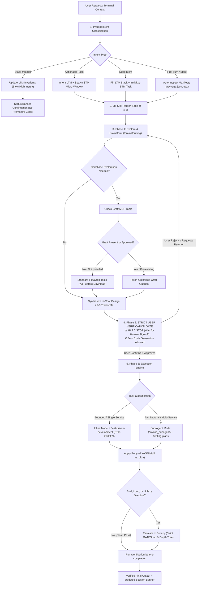

# Backend-Master System Architecture

This document provides a comprehensive architectural overview of **`Backend-Master`**, explaining how the orchestrator processes user intent, manages memory, routes skills, enforces quality gates, and executes code.

---

## 🏛️ End-to-End System Pipeline



---

## 🧩 Architectural Subsystems

### 1. In-Session Memory Engine (ADR-002)
Maintained purely in conversational memory with zero disk writes.
- **Long-Term Memory (LTM)**: Holds project-level invariants (e.g. Node.js + Fastify, PostgreSQL with Prisma, Redis cache, JWT auth). It resists rapid change and updates only on explicit architectural migration commands.
- **Short-Term Memory (STM)**: Holds a rolling 2–4 turn micro-window tracking immediate task progression (e.g. proposed schema $\rightarrow$ user feedback $\rightarrow$ test suite $\rightarrow$ implementation). Automatically resets upon task conclusion.

### 2. Multi-Framework Monorepo Router (ADR-003)
Enables seamless work across multi-tier, polyglot architectures.
- Dynamically maps subdirectories to framework specialists:
  - `services/api` $\rightarrow$ Fastify (`fastify-best-practices`)
  - `services/worker` $\rightarrow$ Go (`golang-pro`)
  - `services/ml` $\rightarrow$ FastAPI (`fastapi-expert`)
- Keeps framework idioms strictly isolated while coordinating inter-service protocols (gRPC, REST, Kafka).

### 3. JIT Skill Injection Engine (ADR-001, ADR-007)
Acts as a transparent proxy for the 73 curated sub-skills in [`skills/`](../skills/):
- **Rule of $\le 3$**: Never loads more than 3 domain skills simultaneously, preventing context bloat.
- **Fluid Progression**: As work advances through Database $\rightarrow$ API $\rightarrow$ Queue $\rightarrow$ Docker $\rightarrow$ Testing, the orchestrator automatically rotates active STM skills without requiring manual user commands.

### 4. Mandatory Plan-Then-Execute Gate (ADR-004)
- **Phase 1**: Context exploration, task scope classification (Spike, Bounded, Architectural), and presentation of trade-offs.
- **Phase 2 (HARD STOP)**: Explicit halt. Zero production files are written or modified until the human engineer gives direct approval.
- **Phase 3**: Execution via TDD or subagents, verified by automated test suites.

### 5. Circuit Breakers & Optimizers
- **Graft MCP Optimizer (ADR-005)**: Token-saving codebase queries. Strictly opt-in; requires explicit user permission before downloading or installing.
- **Ponytail YAGNI Optimizer (ADR-008)**: Enforces native framework and standard library solutions. Switches to ultra mode for hotfixes and bug repairs.
- **Unlazy Breakthrough Breaker (ADR-006)**: Dormant by default. Activates automatically upon stall/loop detection or explicit directive, enforcing formal `GATES.md` acceptance criteria.

---

## 📁 Repository Directory Structure

```text
Backend-Master/
├── .github/
│   └── workflows/
│       └── ci.yml               # Automated GitHub Actions test runner
├── assets/
│   └── banner.svg               # Repository visual banner
├── docs/
│   ├── ARCHITECTURE.md          # This system architecture specification
│   ├── README.md                # Documentation index
│   └── decisions/               # Architecture Decision Records (ADRs)
│       ├── README.md            # ADR index and lifecycle guide
│       ├── ADR-001-universal-orchestrator-and-jit-injection.md
│       ├── ADR-002-in-session-memory-engine-ltm-stm.md
│       ├── ADR-003-polyglot-monorepo-and-multi-framework-routing.md
│       ├── ADR-004-mandatory-plan-then-execute-hard-gate.md
│       ├── ADR-005-token-optimization-via-graft-with-user-consent.md
│       ├── ADR-006-autonomous-breakthrough-circuit-breaker-unlazy.md
│       ├── ADR-007-zero-hassle-transparent-proxy-and-multi-stage-workflow.md
│       ├── ADR-008-ponytail-yagni-discipline-integration.md
│       └── ADR-009-standalone-curated-skill-replicas-and-upstream-tracking.md
├── scripts/
│   ├── check-updates.ps1        # Upstream and local drift detection
│   ├── sync-skills.ps1          # Deterministic skill mirror script
│   └── test-sync.ps1            # Automated test suite (8 regression tests)
├── skills/                      # 73 self-contained curated sub-skills + backend-master
│   ├── backend-master/          # Master orchestrator skill definition
│   ├── clean-ddd-hexagonal/
│   ├── fastapi-expert/
│   ├── fastify-best-practices/
│   ├── postgres-pro/
│   ├── k6/
│   └── ...                      # Full curated catalog
├── package.json                 # Package metadata
├── README.md                    # Primary repository overview
├── REFERENCES.md                # Upstream attribution & license registry
├── SKILL.md                     # Root skill definition
└── upstream-lock.json           # Pinned upstream commit SHAs & source tracking
```
